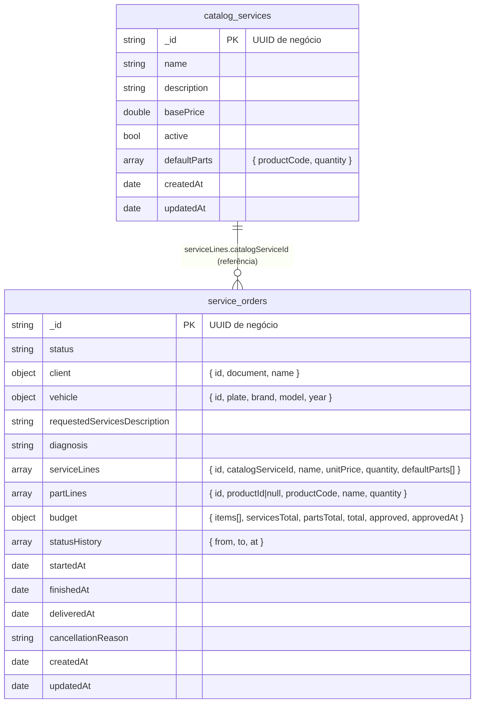

# order-service

Microsserviço de ordens de serviço: OS, orçamento e catálogo de serviços (MongoDB — database **`order`**).



| Coleção | Papel | Observação |
|---|---|---|
| `catalog_services` | Catálogo de serviços e peças padrão | `defaultParts` embutido, referencia produto por `productCode` |
| `service_orders` | OS com cliente/veículo (snapshot), linhas, orçamento e histórico | tudo embutido no documento; `partLines[].productId` vem do lookup no estoque (`null` se desconhecido) |

Índices: `service_orders` em `status+createdAt`, `client.document+status`, `vehicle.plate`, `startedAt+finishedAt`; `catalog_services` em `active` e `name`.

Cliente, veículo e produto pertencem a outros serviços. Os ports (`CLIENT_LOOKUP`, `VEHICLE_LOOKUP`, `PRODUCT_LOOKUP`, `*_PROVISIONING`, `STOCK_SERVICE`) têm adapters HTTP em `src/order/infrastructure/adapters/`, configurados por `IDENTITY_SERVICE_URL` e `STOCK_SERVICE_URL`. Sem a URL, a chamada responde **503** com erro explícito (`INTEGRATION_NOT_CONFIGURED`) e registra `IntegrationFailureEvent`. Os endpoints esperados nos outros serviços estão descritos no código de cada adapter. Nos testes de integração entram fakes em memória.

Auth: JWT emitido pelo **identity-service** (mesmo `JWT_SECRET`). Este MS só valida assinatura e papéis (`UserRole`/`AuthRoles`); não há banco de usuários.

## Rodando local

```bash
cp .env.example .env
docker compose up -d order-mongo        # Mongo em localhost:27018
node scripts/seed-mongo.mjs             # catálogo demo + índices
yarn start:dev                          # API em http://localhost:3000 (compose: 3003)
```

Compose: `order` em `3003:3000`, `order-mongo` (`mongo:7`) em `27018:27017`. A imagem de dev é construída pelo `Dockerfile` (`FROM node:22-bookworm`); se o pull do Node falhar, rode a API no host com `yarn start:dev`.

Testes: `yarn test` (unit, cobertura mínima ~80% em `service-order` e `service-order-status`) e `yarn test:integration:docker` (usa o banco `order_integration` no Mongo da porta 27018).

## Filas

Ainda **não**. HTTP. Na Saga (order ↔ stock), baixa de estoque tende a ir para fila — ainda não implementado.

## CI/CD

| Workflow | Quando | O que faz |
|---|---|---|
| `CI — order-service` | push/PR | unit + integração (service `mongo:7`, `MONGODB_URI`) + build |
| `CD — order-service (Kind)` | manual | lab Kind com manifests `k8s/order-*` e Job `order-seed` |
| `Publish ECR — order-service` | push `main` | push `order-service` + `order-service-seed` |

K8s: `order`, `order-mongo`, `order-config`, `order-secret`, NodePort **30083**.

## Observabilidade

Filtro: `service = 'order-service'` (componente `order`). Eventos de negócio: `ServiceOrderEvent` e `IntegrationFailureEvent`.
