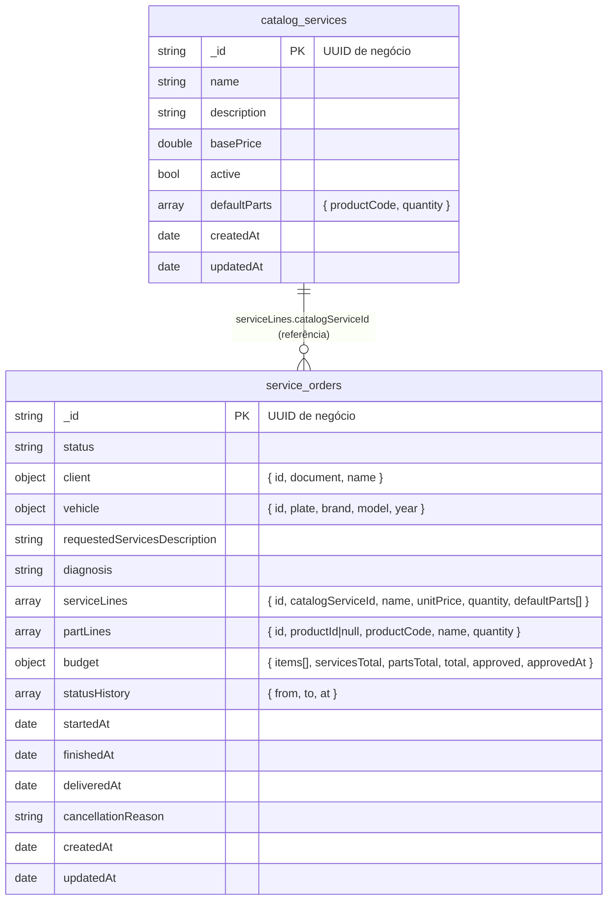

# order-service

Microsserviço de ordens de serviço: OS, orçamento e catálogo de serviços (MongoDB — database **`order`**).



| Coleção | Papel | Observação |
|---|---|---|
| `catalog_services` | Catálogo de serviços e peças padrão | `defaultParts` embutido, referencia produto por `productCode` |
| `service_orders` | OS com cliente/veículo (snapshot), linhas, orçamento e histórico | tudo embutido no documento; `partLines[].productId` vem do lookup no estoque (`null` se desconhecido) |

Índices: `service_orders` em `status+createdAt`, `client.document+status`, `vehicle.plate`, `startedAt+finishedAt`; `catalog_services` em `active` e `name`.

Cliente, veículo e produto pertencem a outros serviços. Os ports (`CLIENT_LOOKUP`, `VEHICLE_LOOKUP`, `PRODUCT_LOOKUP`, `*_PROVISIONING`, `STOCK_SERVICE`) têm adapters HTTP em `src/order/infrastructure/adapters/`, configurados por `IDENTITY_SERVICE_URL` e `STOCK_SERVICE_URL`. Sem a URL, a chamada responde **503** com erro explícito (`INTEGRATION_NOT_CONFIGURED`) e registra `IntegrationFailureEvent`. Os endpoints esperados nos outros serviços estão descritos no código de cada adapter. Nos testes de integração entram fakes em memória.

Auth: JWT emitido pelo **identity-service** (mesmo `JWT_SECRET`). Este MS só valida assinatura e papéis (`UserRole`/`AuthRoles`); não há banco de usuários.

## Rodando local

```bash
docker network create oficina-net 2>/dev/null || true
cp .env.example .env
docker compose up -d          # order :3003, mongo :27018, order-localstack :4567
# (opcional no host) node scripts/seed-mongo.mjs && yarn start:dev
```

Compose sobe **LocalStack próprio** (`order-localstack`, porta host **4567**): topic `oficina-domain-events`, fila `order-events`, policies SNS/SQS e FilterPolicy dos eventos que o order consome. O app publica com fan-out (`SNS_FANOUT_ENDPOINTS`) nos 3 LocalStacks (order/stock/billing). Sem `SNS_TOPIC_ARN`, o publisher fica noop.

Lab completo (4 MS + rede): ver [`../README.md`](../README.md).

Testes: `yarn test` (unit, cobertura mínima ~80% em `service-order` e `service-order-status`) e `yarn test:integration:docker` (usa o banco `order_integration` no Mongo da porta 27018).

## Saga (coreografia) e mensageria

**Saga coreografada** via SNS `oficina-domain-events` + SQS `order-events` (1 broker LocalStack por domínio no lab).
Não há orquestrador central: cada serviço reage a eventos e publica o próximo passo (ou a compensação). `correlationId` da saga = **id da OS**.

| Evento consumido | Efeito na OS |
|---|---|
| `billing.budget.generated` | Aplica orçamento → `WAITING_APPROVAL` |
| `billing.budget.failed` | Volta a `IN_DIAGNOSIS` |
| `billing.payment.created` | `WAITING_PAYMENT` |
| `billing.payment.confirmed` | `IN_EXECUTION` |
| `billing.payment.failed` / `stock.reservation.failed` | `CANCELLED` + publica `order.cancelled` |

| Evento publicado | Quando |
|---|---|
| `order.budget.requested` | `POST .../budget` (status `WAITING_BUDGET`) |
| `order.budget.approved` | Aprovação do orçamento (sem baixar estoque síncrono) |
| `order.budget.rejected` / `order.cancelled` | Reprovação ou falha da saga |

Swagger: `/api`. Health: `/health/live`, `/health/ready`.

## CI/CD (AWS)

Deploy em **EKS** (sem Kind). MongoDB roda **in-cluster** no EKS (lab sem DocumentDB).

| Workflow | Quando | O que faz |
|---|---|---|
| `CI — order-service` | push/PR | unit + integração + build |
| `Publish ECR — order-service` | push `main` | push ECR + dispara deploy no `infra-kubernetes` |

Detalhes: [`infra/README.md`](infra/README.md).

## Observabilidade

Filtro: `service = 'order-service'` (componente `order`). Eventos de negócio: `ServiceOrderEvent` e `IntegrationFailureEvent`.
